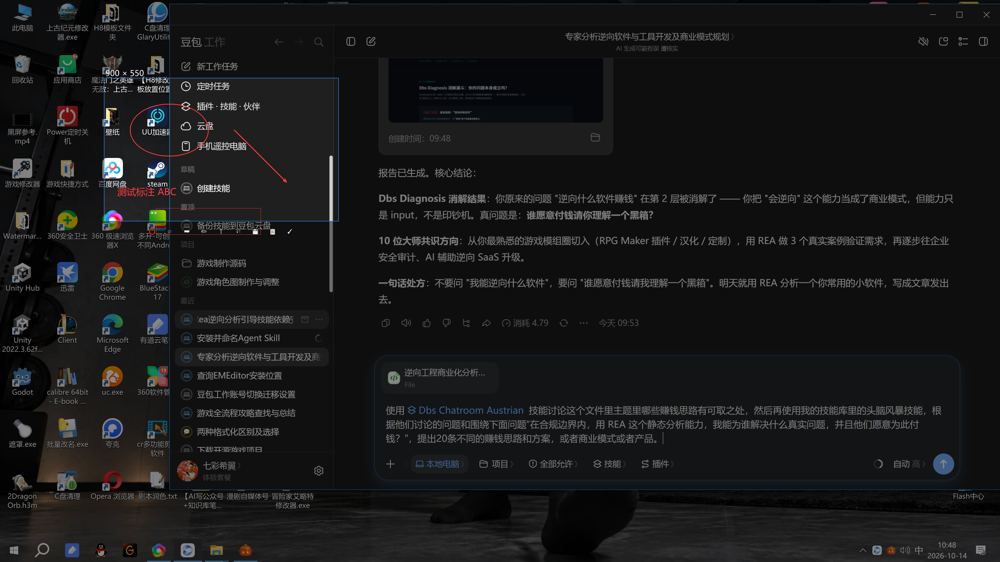

# QQ Screenshot

> 没有装 QQ 的电脑，也能用上 QQ 截图。
> Use the QQ-style region screenshot tool on any Windows PC — no QQ required.



## 🤔 为什么做这个

QQ 的 `Ctrl+Alt+A` 区域截图是我用过最顺手的截图工具，没有之一。
但问题来了：

- 公司电脑不让装 QQ，就用不上这个快捷键
- 给客户远程时，想截个图标注一下，发现系统自带截图难用得想砸键盘
- 总不能为了个截图工具，专门装几个 G 的聊天软件吧？

所以我干脆自己写了一个，**纯单文件 exe，解压双击就能用**，操作和 QQ 截图一模一样。

## ✨ 功能亮点

- **全局热键** `Ctrl + Alt + A`，任何时候按一下就能截图
- **区域选择**：鼠标拖选，全屏半透明遮罩，和 QQ 一样的手感
- **实时标注**：选完区域直接画红圈、矩形、箭头、画笔、文字，拖拽时实时显示
- **自动保存**：截完自动存到桌面，命名 `1.png`、`2.png`、`3.png` 递增
  - 10 分钟内连续截图自动续号
  - 超过 10 分钟没截图，下次从 `1.png` 重新开始
- **复制到剪贴板**：截完直接 Ctrl+V 粘贴到聊天框/文档
- **右键托盘**：随时改保存目录，不用翻配置文件
- **单实例检测**：重复双击 exe 会提示"已经在运行"，不会起一堆进程
- **零依赖**：不用装 Python，不用装运行库，Windows 10/11 64 位直接跑

## 🚀 快速开始

1. 去 [Releases](../../releases) 下载最新的 `QQ-Screenshot.exe`
2. 双击运行（右下角托盘出现小图标）
3. 按 `Ctrl + Alt + A`，拖选区域，标注，回车完成
4. 截图自动保存到桌面，同时复制到剪贴板

| 快捷键 | 作用 |
|---|---|
| `Ctrl + Alt + A` | 唤起截图 |
| 鼠标拖拽 | 选择区域 |
| 工具栏 | 红圈 / 矩形 / 箭头 / 画笔 / 文字 / 撤销 / 保存 / 复制 / 完成 |
| `Enter` | 完成并保存 |
| `Esc` | 取消截图 |
| 鼠标右键 | 取消截图 |


## 📂 首次使用

第一次双击 exe 会让你选一个保存目录，选完就记住了。
以后想换地方，右键托盘图标 → "设置保存目录"。

## 🛠️ 自己编译

源码就是一个 `screenshot.py`，基于 PyQt5。想自己改：

```bash
pip install PyQt5 pyinstaller
pyinstaller --onefile --windowed --name QQ-Screenshot screenshot.py
```

## 📋 系统要求

- Windows 10 / 11（64 位）
- 不需要 .NET，不需要 VC++ 运行库，不需要任何东西

## 📄 License

MIT，随便用、随便改、随便转发。

---

# English

## Why I built this

QQ's `Ctrl+Alt+A` region screenshot is honestly the best screenshot tool I've ever used.
But:

- Work PCs often block QQ installation, and you lose that shortcut forever
- System screenshot tools on Windows are painfully bare-bones
- Installing a multi-GB chat app just to take screenshots is ridiculous

So I reimplemented it as a **single standalone exe** — same interaction, same shortcuts, no QQ required.

## Features

- **Global hotkey** `Ctrl + Alt + A` from anywhere
- **Region selection** with a fullscreen dim overlay, just like QQ
- **Live annotations**: red ellipse, rectangle, arrow, freehand pen, text — drawn in real time as you drag
- **Auto-save** to desktop as `1.png`, `2.png`, `3.png`...
  - Counter continues within a 10-minute session
  - After 10 minutes of inactivity, restarts from `1.png`
- **Auto-copy to clipboard** — Ctrl+V straight into any chat or doc
- **Tray icon** — right-click to change the save folder anytime
- **Single-instance guard** — launching twice shows a friendly "already running" dialog
- **Zero dependencies** — no Python, no runtime, just one .exe

## Quick start

1. Download `QQ-Screenshot.exe` from [Releases](../../releases)
2. Double-click (tray icon appears)
3. Press `Ctrl + Alt + A`, drag a region, annotate, hit Enter
4. Done — file is saved and copied to clipboard

## Build from source

```bash
pip install PyQt5 pyinstaller
pyinstaller --onefile --windowed --name QQ-Screenshot screenshot.py
```

## Requirements

- Windows 10 / 11 (64-bit)
- Nothing else. Seriously.

## License

MIT. Use it, fork it, ship it.
